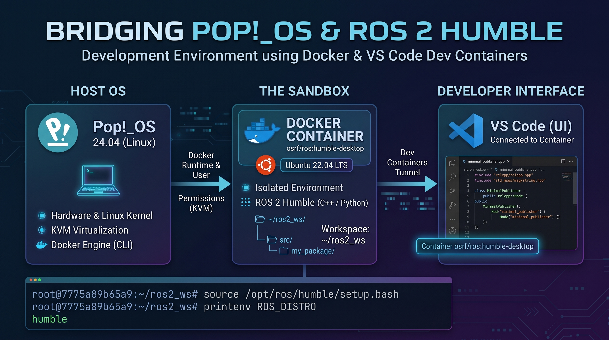

<div align="center">

# 🤖 ROS 2 Humble Dev Container

### Your robotics workspace, isolated and ready to build.

[](https://docs.ros.org/en/humble/)
[](https://releases.ubuntu.com/22.04/)
[](https://www.docker.com/)
[](https://code.visualstudio.com/docs/devcontainers/containers)
[](https://pop.system76.com/)
[](LICENSE)

**A clean, reproducible Docker and VS Code development environment for ROS 2 Humble—without changing your host dependencies or maintaining a dual boot.**

<br>



</div>

---

## 🧭 Table of Contents

- [Overview](#-overview)
- [Why This Project Exists](#-why-this-project-exists)
- [What You Get](#-what-you-get)
- [How It Works](#-how-it-works)
- [Requirements](#-requirements)
- [Quick Start](#-quick-start)
- [Opening the Environment](#-opening-the-environment)
- [Verifying the Installation](#-verifying-the-installation)
- [Creating a ROS 2 Package](#-creating-a-ros-2-package)
- [Building and Sourcing](#-building-and-sourcing)
- [Running a Test Package](#-running-a-test-package)
- [Repository Structure](#-repository-structure)
- [Configuration Files](#-configuration-files)
- [Docker Commands](#-docker-commands)
- [VS Code Commands](#-vs-code-commands)
- [GUI Applications](#-gui-applications)
- [Networking](#-networking)
- [Troubleshooting](#-troubleshooting)
- [Roadmap](#-roadmap)
- [Contributing](#-contributing)
- [License](#-license)

---

## 🚀 Overview

This repository provides a **ROS 2 Humble development container** for Linux workstations running Pop!_OS 24.04 or Ubuntu 24.04.

The container environment includes:

- Ubuntu 22.04
- ROS 2 Humble Desktop
- `colcon`
- C++ build tools
- Git
- Bash completion
- Nano
- VS Code C/C++, CMake, and Python extensions

Your project files remain on the host, while ROS 2 dependencies execute inside Docker.

```text
Host computer
│
├── VS Code
├── Docker Engine
└── Repository files
        │
        ▼
ROS 2 Humble container
│
├── Ubuntu 22.04
├── ROS 2 Humble
├── colcon
├── build-essential
└── /root/ros2_ws
```

---

## 💡 Why This Project Exists

ROS 2 Humble is officially associated with Ubuntu 22.04.

Modern distributions such as Pop!_OS 24.04 and Ubuntu 24.04 may use newer system libraries that are incompatible with older robotics tooling. Installing ROS 2 Humble directly on the host can also affect existing packages and system dependencies.

This project solves the problem by:

- Keeping ROS 2 isolated from the host system
- Providing a repeatable environment
- Using a Dev Container for one-click VS Code setup
- Making ROS workspaces portable
- Preventing the need for a separate dual-boot installation
- Keeping source code outside the container

---

## ✨ What You Get

| Feature | Status |
|---|---|
| ROS 2 Humble Desktop | ✅ Included |
| Ubuntu 22.04 container | ✅ Included |
| Docker Compose | ✅ Included |
| VS Code Dev Container | ✅ Included |
| Automatic ROS sourcing | ✅ Included |
| Workspace volume mount | ✅ Included |
| Host networking | ✅ Included |
| `colcon` build tools | ✅ Included |
| C++ build tools | ✅ Included |
| Python and CMake VS Code support | ✅ Included |
| Persistent source code | ✅ Included |
| RViz2 / Gazebo GUI forwarding | 🚧 Prepared, not fully enabled |
| NVIDIA GPU passthrough | 🚧 Prepared, not fully enabled |
| ROS 2 sample packages | ⏳ Planned |

---

## 🧩 How It Works

### Host Layer

The host system runs:

- Docker Engine
- Docker Compose
- Visual Studio Code
- The Dev Containers extension

The host does not need to install ROS 2 Humble.

### Container Layer

Docker builds an image based on:

```dockerfile
FROM osrf/ros:humble-desktop
```

The resulting container provides the ROS 2 Humble environment.

### Workspace Layer

Docker Compose mounts the repository directory into the container:

```yaml
volumes:
  - .:/root/ros2_ws:cached
```

The repository directory is therefore available inside the container at:

```text
/root/ros2_ws
```

Changes made in VS Code are immediately reflected inside the container.

---

## 🧰 Requirements

### Required

- Linux host, preferably:
  - Pop!_OS 24.04
  - Ubuntu 24.04
- Docker Engine
- Docker Compose
- Visual Studio Code
- Internet access for the initial image build

### Required VS Code Extension

- [Dev Containers](https://marketplace.visualstudio.com/items?itemName=ms-vscode-remote.remote-containers)

### Optional

- Docker Desktop compatibility layer
- NVIDIA Container Toolkit
- X11 forwarding support
- A graphical desktop environment

> ARM64 support is not guaranteed unless the required ROS images support it.

---

## ⚡ Quick Start

### 1. Verify Docker

```bash
docker --version
docker compose version
```

Docker Compose must run without a `sudo` requirement if it is being used as a regular user.

If Docker requires permission setup, follow your Linux distribution's Docker installation instructions.

### 2. Clone the Repository

```bash
git clone https://github.com/M7md-salah/ros2-humble-devcontainer.git
cd ros2-humble-devcontainer
```

### 3. Open in VS Code

```bash
code .
```

### 4. Reopen in the Container

Choose one of these methods:

#### Method A

Wait for the notification and click:

```text
Reopen in Container
```

#### Method B

Open the VS Code Command Palette:

```text
Ctrl + Shift + P
```

Then run:

```text
Dev Containers: Reopen in Container
```

---

## 🏗️ Opening the Environment

VS Code reads:

```text
.devcontainer/devcontainer.json
```

This file identifies:

- The Docker Compose file
- The container service
- The workspace folder
- Recommended VS Code extensions
- The default terminal profile

The workspace opens at:

```text
/root/ros2_ws
```

The repository directory remains mounted at the same location.

---

## ✅ Verifying the Installation

Open a terminal inside VS Code.

Check the installed ROS distribution:

```bash
printenv ROS_DISTRO
```

Expected output:

```text
humble
```

Check the ROS 2 command:

```bash
ros2 --help
```

List available ROS topics:

```bash
ros2 topic list
```

Check the ROS environment:

```bash
env | grep -E 'ROS_DISTRO|AMENT_PREFIX_PATH|ROS_VERSION'
```

Source the ROS environment manually if needed:

```bash
source /opt/ros/humble/setup.bash
```

The container adds this command automatically to `~/.bashrc`, so a newly opened Bash terminal should already have it sourced.

---

## 📦 Creating a ROS 2 Package

Place new ROS 2 packages inside the repository's `src/` directory.

Navigate to the workspace:

```bash
cd /root/ros2_ws
```

Create a C++ package:

```bash
ros2 pkg create \
  --build-type ament_cmake \
  --destination-directory src \
  my_cpp_package
```

Create a Python package:

```bash
ros2 pkg create \
  --build-type ament_python \
  --destination-directory src \
  my_python_package
```

Use clear package names and avoid adding spaces or special characters.

---

## 🔨 Building and Sourcing

### Build the Workspace

From `/root/ros2_ws`:

```bash
colcon build --symlink-install
```

For a cleaner rebuild:

```bash
colcon build --cmake-clean-cache --symlink-install
```

Build only one package:

```bash
colcon build --packages-select my_cpp_package --symlink-install
```

### Source the Workspace

```bash
source install/setup.bash
```

The Docker configuration attempts to source this file automatically from `~/.bashrc`:

```bash
if [ -f /root/ros2_ws/install/setup.bash ]; then
  source /root/ros2_ws/install/setup.bash;
fi
```

To source both ROS and the workspace explicitly:

```bash
source /opt/ros/humble/setup.bash
source /root/ros2_ws/install/setup.bash
```

---

## 🧪 Running a Test Package

A new package may be tested after adding executable nodes.

For an existing executable:

```bash
ros2 run <package_name> <executable_name>
```

For example:

```bash
ros2 run demo_nodes_cpp talker
```

Open a second container terminal and run:

```bash
ros2 run demo_nodes_cpp listener
```

The publisher and subscriber should communicate through the host network.

Demo packages are available if they are part of the active ROS installation.

---

## 📁 Repository Structure

```text
ros2-humble-devcontainer/
│
├── .devcontainer/
│   ├── Dockerfile
│   │   └── Builds the ROS 2 Humble development image
│   │
│   └── devcontainer.json
│       └── Configures VS Code and the container
│
├── assets/
│   └── architecture.jpeg
│       └── Project architecture diagram
│
├── src/
│   └── ROS 2 package source directories
│
├── docker-compose.yml
│   └── Container service, workspace mount, and networking
│
├── .gitignore
│   └── Excludes generated ROS workspace directories
│
└── README.md
    └── Project documentation
```

---

## ⚙️ Configuration Files

### `.devcontainer/Dockerfile`

The Dockerfile:

1. Starts from `osrf/ros:humble-desktop`
2. Sets a noninteractive package installation mode
3. Uses Bash as the container shell
4. Installs Git, Nano, Bash completion, and build tools
5. Installs Python `colcon` extensions
6. Sets `/root/ros2_ws` as the working directory
7. Sources ROS Humble automatically

### `.devcontainer/devcontainer.json`

The Dev Container configuration:

- Uses `docker-compose.yml`
- Starts the `ros2_humble_dev` service
- Opens the `/root/ros2_ws` workspace
- Installs C++, CMake, and Python extensions
- Uses Bash as the integrated terminal profile

### `docker-compose.yml`

The Compose configuration:

- Builds with `.devcontainer/Dockerfile`
- Names the container `ros2_humble_dev`
- Uses host networking
- Opens a persistent terminal
- Mounts the repository into `/root/ros2_ws`
- Sets `ROS_DISTRO=humble`

---

## 🐳 Docker Commands

Run a service manually:

```bash
docker compose up
```

Build or rebuild the container:

```bash
docker compose build
```

Build without using cached layers:

```bash
docker compose build --no-cache
```

Start and keep the container running:

```bash
docker compose up -d
```

Open a shell in the running container:

```bash
docker exec -it ros2_humble_dev bash
```

Stop the container:

```bash
docker compose down
```

Remove stopped containers, networks, and generated Compose resources:

```bash
docker compose down --volumes
```

View running containers:

```bash
docker ps
```

View container logs:

```bash
docker compose logs -f
```

---

## 🔁 VS Code Commands

Useful command-palette actions:

```text
Dev Containers: Reopen in Container
Dev Containers: Rebuild Container
Dev Containers: Rebuild and Reopen in Container
Dev Containers: Reopen Folder Locally
Dev Containers: Open Folder in Container
```

### Rebuild after Dockerfile changes

Run:

```text
Dev Containers: Rebuild Container
```

Use this after changing:

- `.devcontainer/Dockerfile`
- `docker-compose.yml`
- `.devcontainer/devcontainer.json`
- Installed packages or VS Code extensions

---

## 🖥️ GUI Applications

`docker-compose.yml` contains placeholders for GUI support:

```yaml
# - /tmp/.X11-unix:/tmp/.X11-unix:rw
# - DISPLAY=${DISPLAY}
```

They are commented out and **not fully enabled**.

To use RViz2 or Gazebo, GUI forwarding must be configured for the host system. X11 setup varies across desktop environments and Wayland sessions.

### Example X11 guidance

On a compatible X11 host:

```bash
echo $DISPLAY
```

Display the X11 socket:

```bash
ls /tmp/.X11-unix
```

Allow local container access:

```bash
xhost +local:
```

Then uncomment the GUI-related Compose lines:

```yaml
volumes:
  - /tmp/.X11-unix:/tmp/.X11-unix:rw

environment:
  - DISPLAY=${DISPLAY}
```

Rebuild and reopen the container afterward.

> GUI forwarding and NVIDIA support require additional host configuration. They are not enabled in the current repository.

---

## 🌐 Networking

The container uses:

```yaml
network_mode: host
```

Host networking is useful for ROS 2 DDS communication because it allows the container to discover nodes, services, actions, and topics directly on the host network.

Potential limitations:

- Exposed container ports are unnecessary
- Network discovery depends on the host firewall
- Multiple devices may require DDS configuration
- Host-network behavior differs on macOS and Windows

On Linux, host networking provides the most direct ROS 2 development experience.

---

## 🛠️ Troubleshooting

### Docker permission denied

If Docker reports permission errors:

```text
permission denied while trying to connect to the Docker daemon
```

Verify that Docker is running and that your user is allowed to access the Docker socket.

On distributions using systemd:

```bash
sudo systemctl status docker
sudo systemctl start docker
```

Restart VS Code after changing Docker group membership.

### Dev Container is not detected

Verify that:

- The Dev Containers extension is installed
- `.devcontainer/devcontainer.json` exists
- Docker is running
- The repository was opened locally before reopening in a container

### ROS Humble is not sourced

Open a new terminal and run:

```bash
source /opt/ros/humble/setup.bash
printenv ROS_DISTRO
```

Then rebuild the container if `.bashrc` was modified.

### Package cannot be found

Build the workspace:

```bash
colcon build --symlink-install
source install/setup.bash
```

Verify that the package directory exists:

```bash
find src -maxdepth 2 -type f -name package.xml
```

### RViz or Gazebo will not open

The repository does not currently enable GUI forwarding by default.

Check:

- Whether the host is using X11 or Wayland
- Whether `/tmp/.X11-unix` is accessible
- Whether `DISPLAY` is set
- Whether X11 access permissions are allowed
- Whether the container is being rebuilt after Compose changes

### Colcon build fails

Clean the workspace and rebuild:

```bash
rm -rf build install log
colcon build --symlink-install
```

Do not remove source code inside `src/`.

### Container starts but files are missing

Confirm that the repository is mounted:

```bash
ls -la /root/ros2_ws
```

Then check that Docker Compose uses the correct workspace path and build context.

---

## 🗺️ Roadmap

- [x] Ubuntu 22.04 and ROS 2 Humble container
- [x] VS Code Dev Container integration
- [x] Automatic ROS environment sourcing
- [x] Host-network ROS communication
- [x] Workspace mount for persistent source code
- [ ] Enable and document X11 forwarding
- [ ] Add NVIDIA GPU passthrough documentation
- [ ] Add RViz2 and Gazebo launch instructions
- [ ] Add a C++ publisher/subscriber example
- [ ] Add a Python publisher/subscriber example
- [ ] Add example `colcon` build scripts
- [ ] Add automated environment verification
- [ ] Add hardware-device passthrough examples
- [ ] Add a license

---

## 🤝 Contributing

Contributions are welcome.

1. Fork the repository.
2. Create a branch:

```bash
git checkout -b feature/improve-container
```

3. Make your changes.
4. Rebuild and test the container.
5. Verify the ROS environment:

```bash
printenv ROS_DISTRO
ros2 topic list
colcon build --symlink-install
```

6. Commit and push:

```bash
git add .
git commit -m "Improve ROS 2 dev container"
git push origin feature/improve-container
```

7. Open a pull request.

When contributing Docker changes, include:

- Affected files
- Host system used for testing
- Docker version
- ROS verification commands
- GUI or hardware requirements

---

## 📜 License

This repository does not currently include a license file.

A license should be added before the project is reused or redistributed commercially. Until then, the repository should be treated as an unlicensed project.

---

<div align="center">

## 🧠 Built for Focused Robotics Development

### Less setup. Less system risk. More building.

**Keep the host clean. Put the robotics toolchain in a container.**

</div>
